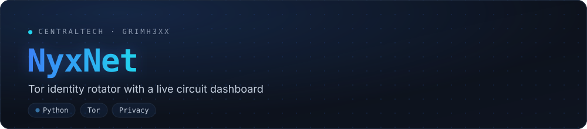
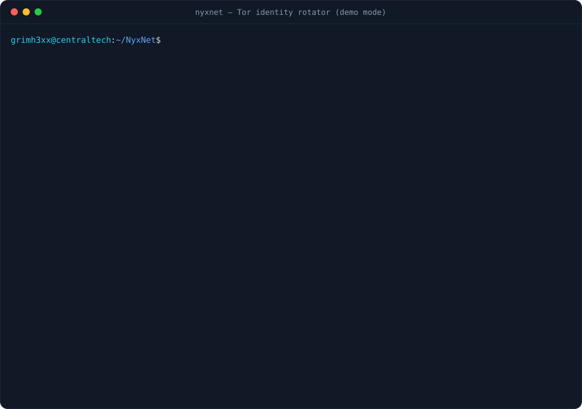

<div align="center">



**Tor identity rotator with a live circuit dashboard.**
Requests a new Tor identity on a timer, verifies every exit with check.torproject.org
and shows the full guard → middle → exit path, in real time.

[](https://github.com/grimh3xx/NyxNet/actions)
[](https://github.com/grimh3xx/NyxNet/releases/latest)
[](LICENSE)


`CentralTech Solutions` · [centraltechpc.com](https://centraltechpc.com) · [github.com/grimh3xx](https://github.com/grimh3xx)

</div>

<p align="center"></p>

<p align="center"><sub>Recorded with <code>--demo</code>: simulated relays and documentation-range IPs (RFC 5737), no real traffic.</sub></p>

## Features

- **Zero setup.** If no Tor ControlPort is running, NyxNet starts its own private Tor instance
  on random ports with a throwaway data directory. No root, no `torrc` edits, nothing left behind.
- **Verified exits.** Every identity is checked through [check.torproject.org](https://check.torproject.org),
  so the dashboard tells you when traffic is *not* going through Tor instead of assuming it is.
- **Full circuit view.** Guard, middle and exit relays with nickname, country and address,
  resolved from the exact circuit that carried the check.
- **Respects Tor.** `NEWNYM` is rate-limited by Tor to about one every 10 seconds; NyxNet waits
  for it instead of spamming signals that would be silently dropped.
- **Session stats.** Unique exits, countries, average latency and re-used exits (`↺`).
- **Script friendly.** `--plain` and `--json` print one line per identity; `--once` prints the
  current exit and quits.
- **Private by default.** Your real IP is only ever shown masked (`203.•••.•••.42`) and is never
  written to disk. `--no-real-ip` skips the lookup entirely.
- **Demo mode.** `--demo` runs the whole dashboard on a simulated network, without Tor.

## Quick start

```bash
# 1. Tor itself (only the binary is needed; NyxNet starts it for you)
sudo pacman -S tor          # Arch
sudo apt install tor        # Debian / Ubuntu / Kali
brew install tor            # macOS

# 2. NyxNet
pipx install git+https://github.com/grimh3xx/NyxNet
nyxnet
```

Or from a clone:

```bash
git clone https://github.com/grimh3xx/NyxNet && cd NyxNet
pip install -r requirements.txt
python -m nyxnet --demo     # try it without Tor first
```

Keys: <kbd>n</kbd> new identity now · <kbd>p</kbd> pause · <kbd>q</kbd> quit.

## Usage

```text
nyxnet [-i SEC] [-n N] [--once] [--plain | --json] [tor options] [--demo]
```

| Option | Default | |
|---|---|---|
| `-i, --interval SEC` | `15` | Seconds between new identities (minimum 10, Tor's NEWNYM rate limit) |
| `-n, --count N` | `0` | Stop after N identities (0 = until <kbd>q</kbd> / <kbd>Ctrl-C</kbd>) |
| `--once` | | Print the current exit and quit |
| `--plain` / `--json` | | One line / one JSON object per identity instead of the dashboard |
| `--socks-port`, `--control-port` | `9050`, `9051` | Ports of an existing Tor |
| `--password` | cookie auth | ControlPort password (or `NYXNET_TOR_PASSWORD`) |
| `--launch auto\|always\|never` | `auto` | Start a private Tor only if none is reachable, always, or never |
| `--tor-cmd PATH` | `tor` | Tor binary to launch |
| `--no-real-ip` | | Never look up your real IP |
| `--log FILE` / `--no-log` | `~/.local/state/nyxnet/history.jsonl` | Identity history (exit IP, country, circuit, latency) |
| `--demo` | | Simulated network, no Tor needed |

Examples:

```bash
nyxnet -i 30                         # new identity every 30 s
nyxnet --once                        # where am I exiting right now?
nyxnet --json -n 10 > exits.jsonl    # 10 identities, machine-readable
nyxnet --launch never                # only use the system Tor (fail if absent)
```

## Using the rotating identity

NyxNet changes the identity of the **Tor instance**; your applications must send their
traffic through its SOCKS port (shown in the dashboard as `socks5`):

```bash
curl --socks5-hostname 127.0.0.1:9050 https://check.torproject.org/api/ip
proxychains4 -q nmap -sT -Pn example.com     # with socks5 127.0.0.1 9050 in proxychains.conf
```

When NyxNet launches its own Tor it uses `127.0.0.1:9050` whenever that port is free (another
one otherwise, shown on screen). To use the system Tor instead (`sudo systemctl start tor`),
enable its ControlPort in `/etc/tor/torrc` and NyxNet will attach to it:

```text
ControlPort 9051
CookieAuthentication 1
```

and make sure your user can read the cookie (on most distros: add yourself to the
`tor` / `debian-tor` group).

### In a browser

For browsing, **[Tor Browser](https://www.torproject.org/download/) is the right tool**: a normal
browser behind a SOCKS proxy still leaks through fingerprinting and WebRTC. To see NyxNet's
rotation in a regular Firefox anyway:

1. Settings → Network Settings → **Manual proxy configuration**
2. **SOCKS Host** `127.0.0.1`, **Port** `9050`, **SOCKS v5**
3. Tick **Proxy DNS when using SOCKS v5**
4. In `about:config`, set `media.peerconnection.enabled` to `false` (WebRTC leaks your real IP)

Then open [check.torproject.org](https://check.torproject.org). Under WSL2, Windows browsers can
reach the proxy on `127.0.0.1` too (localhost forwarding is on by default).

## How it works

1. **Connect or launch.** [stem](https://stem.torproject.org) attaches to the ControlPort, or
   starts `tor` with a temporary `DataDirectory`, random `SocksPort`/`ControlPort` and cookie auth.
2. **Check.** A request to `check.torproject.org/api/ip` goes through the SOCKS port (`socks5h`,
   so DNS is resolved by Tor too). A `STREAM` event listener follows that request to the circuit
   that carried it, and the circuit's relays are looked up in the consensus and Tor's GeoIP database.
3. **Rotate.** After the interval, `SIGNAL NEWNYM` marks existing circuits as dirty so new
   connections get a fresh circuit, then the check repeats.

## Limitations

- Rotating identities is **not** extra anonymity. It changes which exit websites see, which is
  useful for testing geo/IP-based behaviour and rate limits, but your guard stays the same by design.
- Only traffic sent to Tor's SOCKS port is affected; NyxNet is not a system-wide VPN.
- An exit can repeat (`↺ reused`): the network has a few thousand exits and Tor weighs them by bandwidth.

## What changed in 2.0

NyxNet was rewritten from scratch: package layout with a `nyxnet` command, private Tor
launcher (no root, no auto-install through the package manager), exit verification,
circuit inspection, NEWNYM rate-limit handling, masked real IP, `--plain`/`--json`/`--once`,
demo mode, tests and CI.

## Legal

For privacy research, testing your own services and education. Respect the
[Tor Project's guidance](https://support.torproject.org/abuse/) and the terms of the
services you access. You are responsible for how you use this tool.

## License

[MIT](LICENSE) © grimh3xx · CentralTech
